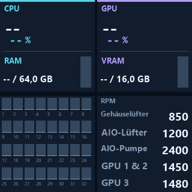
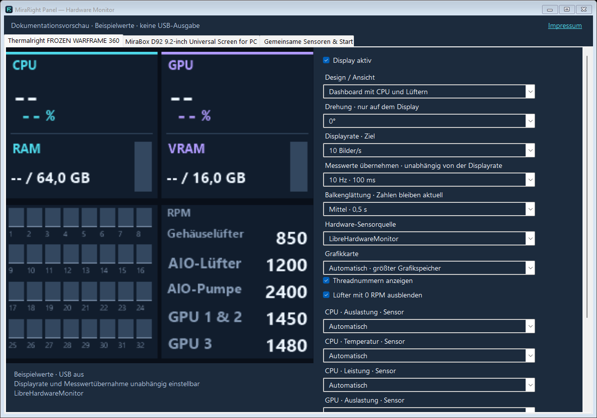
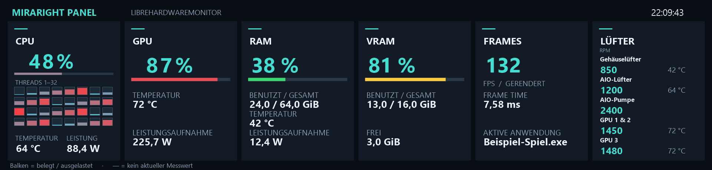
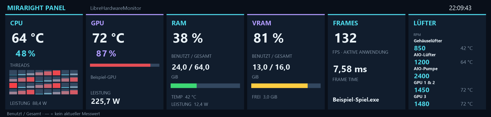
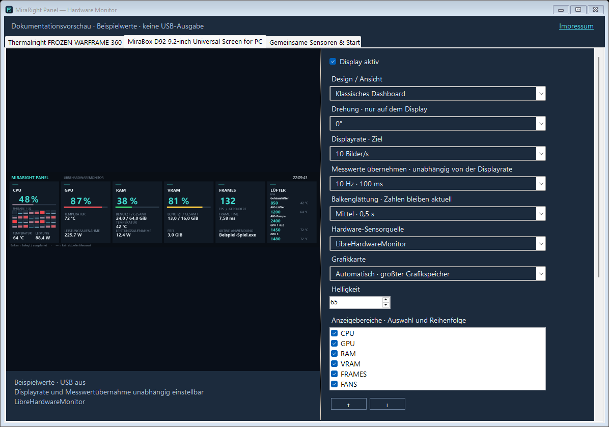

# MiraRight Panel — Hardware Monitor

**Hardware-Monitoring für Thermalright FROZEN WARFRAME 360 LCD und MiraBox D92 9.2-inch Universal Screen for PC.**

[Vorschau](#vorschau) · [Download](#download) · [Anleitung](LIESMICH.txt) · [Unterstützte Modelle](#unterstützte-displays) · [Nutzung & Haftung](NUTZUNG-UND-HAFTUNG.txt) · [Impressum](IMPRINT.txt)

## Wofür ist das Programm?

**MiraRight Panel zeigt PC-Messwerte auf kleinen USB-Hardwaredisplays an.**
Dazu gehören CPU-/GPU-Auslastung und Temperaturen, RAM-/VRAM-Belegung, Lüfterdrehzahlen
und auf dem MiraBox-Layout FPS/Frame Time der aktuell aktiven Anwendung. Verfügbare
Leistungs- und Temperatursensoren lassen sich gezielt auswählen.

Unterstützt werden das getestete **Thermalright FROZEN WARFRAME 360 mit dem unterstützten 320-×-320-LCD-Controller** und das
**MiraBox D92 9.2-inch Universal Screen for PC mit 1920 × 462 Pixeln**. Du kannst eines der Geräte oder beide gleichzeitig
verwenden. Jedes Display bekommt eigene Einstellungen. Das Programm ist kein allgemeiner
Treiber für beliebige USB-Bildschirme und steuert weder Lüfter noch Übertaktung.

Die Anzeige läuft ohne MiraBox Craft oder Thermalright TRCC. LibreHardwareMonitor ist
enthalten; MSI Afterburner ist eine optionale alternative Sensorquelle. Die lokale
Anwendung benötigt weder Anmeldung noch Cloudkonto und lädt keine Messwerte hoch.

Unabhängiges Community-Projekt; kein offizielles Produkt von Thermalright oder MiraBox.

## Vorschau

Die Bilder zeigen die echte Windows-Oberfläche und die von der Anwendung gerenderten
Display-Layouts. Es sind Software-Vorschauen, keine Fotos der Geräte. Die abgebildeten
Messwerte sind feste Beispieldaten für die Dokumentation; verfügbare Sensoren, Werte,
Lüfter und Schriftplatz hängen von deiner Hardware und deinen Einstellungen ab.
`—` bedeutet, dass kein aktueller Messwert vorliegt. Bilder anklicken, um sie in voller Größe zu sehen.

### Thermalright FROZEN WARFRAME 360

Dashboard mit CPU-Gesamtlast, einzelnen CPU-Threads, Temperaturen, Speicher und Lüftern
auf dem unterstützten 320-×-320-Controller. Die Software-Vorschau bleibt bei gedrehter LCD-Ausgabe aufrecht.



Eigene Einstellungen für Ansicht, Drehung, Displayrate, Messwertübernahme,
Balkenglättung, Sensorquelle und einzelne Hardware-Sensoren:



### MiraBox D92 9.2-inch Universal Screen for PC

**Klassisches Dashboard**, 1920 × 462 Pixel, mit CPU-Threads, GPU, RAM/VRAM,
FPS/Frame Time und Lüftern. Bereiche und Reihenfolge sind einstellbar.



**Thermalright-Panorama-Design** als alternative Ansicht auf demselben MiraBox-Display:



MiraBox bekommt ein eigenes Profil, unabhängig von einem gleichzeitig betriebenen Thermalright-LCD:



## Download

Lade das **Windows-x64-Programmpaket** unter [Releases](https://github.com/Starbite82/MiraRight-Panel/releases)
herunter und entpacke das ZIP vollständig. .NET-Laufzeit, Sensorbibliothek und PresentMon sind enthalten.
Die GitHub-Schaltfläche „Code → Download ZIP“ liefert den Quellcode für Entwickler.

## Schnellstart für Nutzer

1. Das passende Windows-x64-Programmpaket vollständig in einen beschreibbaren Ordner entpacken.
2. Andere Programme beenden, die auf dasselbe LCD zugreifen, insbesondere MiraBox Craft oder Thermalright TRCC.
3. **`Start-MiraRight-Panel.cmd`** öffnen. Die .NET-Laufzeit und Sensorbibliotheken sind enthalten.
4. Im Reiter **Thermalright** bzw. **MiraBox D92** die angeschlossenen Displays aktivieren;
   den Reiter eines nicht vorhandenen Geräts deaktivieren.
5. Design, Drehung, Sensorquelle und gewünschte Raten pro Gerät einstellen. Änderungen werden gespeichert.

Für einen Blick auf die Oberfläche ohne USB-Ausgabe **`MiraRight-Panel-Vorschau.cmd`** verwenden.
Diese Vorschau fordert keine Administratorrechte an. Fehlende Sensorwerte erscheinen als `—`.

Die ausführliche [deutsche Anleitung](LIESMICH.txt) erklärt Einrichtung, Sensorrechte,
Autostart, Updates, Backups und Fehlerhilfe.

## Gemeinsam und getrennt

Ein eigener Sensorprozess liest Hardware bis zu 10-mal pro Sekunde und betreibt eine gemeinsame PresentMon-FPS-Erfassung.
Beide Anzeigen wählen daraus unabhängig Sensorquelle, GPU und einzelne Sensoren. Jede Anzeige hat eigene
Messwertübernahme, Displayrate, Glättung, Design und Ausrichtung. Ein fehlendes oder blockiertes Gerät
unterbricht die andere Anzeige nicht. Vorschauen bleiben aufrecht.

Für Thermalright stehen sieben Ansichten und eine Drehung um 0/90/180/270° zur Wahl.
Für MiraBox sind klassisches/Panorama-Design, Bereiche/Reihenfolge, Helligkeit und 0/180°-Drehung einstellbar.
RAM/VRAM zeigen benutzt/gesamt; die Lastfarben und stabilen Prozentzeichen bleiben erhalten.

## Unterstützte Displays

| Display | Auflösung | Unterstützter Controller |
| --- | --- | --- |
| Thermalright FROZEN WARFRAME 360 · unterstützte LCD-Variante | 320 × 320 Pixel | USB `87AD:70DB`, Handshake PM32/SUB1 |
| MiraBox D92 9.2-inch Universal Screen for PC | 1920 × 462 Pixel | USB `5548:1011` |

**Thermalright FROZEN WARFRAME 360:** Innerhalb der Frozen-Warframe-Reihe gibt es unterschiedliche
LCD-Controller und Auflösungen. Prüfe deshalb die USB-Kennung im Windows-Geräte-Manager.
Ein gleicher Kühlername allein bestätigt die Kompatibilität nicht. Der hier getestete Thermalright-
Controller ist oben angegeben; andere Warframe-/SE-/Pro-Varianten sind nicht pauschal unterstützt.

Das D92 wird direkt über Windows HID angesprochen. Für das Thermalright-LCD wird der bereits
vorhandene passende WinUSB-Treiber benötigt. Die Anwendung installiert keine Treiber.
Eines der unterstützten Displays genügt; zwei gleichzeitig sind optional.

## Messwerte und Rechte

Die Produktbezeichnungen entsprechen der [Thermalright-Modellseite](https://www.thermalright.com/product/frozen-warframe-360-black-x/) und der [MiraBox-D92-Modellseite](https://mirabox.net/products/mirabox-9-2-inch-universal-screen). Die Modellreihe ersetzt nicht die oben genannte Controllerprüfung.

Fehlende Werte erscheinen als `—`; nicht jede Hardware liefert alle Temperaturen oder Wattwerte.
Nur der separate Sensorprozess benötigt optional eine Windows-Administratorbestätigung.
Die Oberfläche läuft normal. Der Vorschaumodus fordert keine Administratorrechte an.
Die ausführliche Anleitung erklärt die Einstellung und die möglichen UAC-Abfragen beim Start.

## Updates und Einstellungen

Einstellungen werden in `displays.json` gespeichert. Für ein Update die Anwendung vollständig
im Tray beenden, den bisherigen Ordner sichern und die Konfiguration in den neuen Ordner übernehmen.
Einrichtung, Autostart und die optionale Übernahme älterer Konfigurationen stehen in der Anleitung.

## Nutzung, Gewährleistung und Haftung

Kostenloses Open-Source-Hobbyprojekt, bereitgestellt im vorhandenen Zustand.
Eine Garantie für Fehlerfreiheit, Messgenauigkeit oder Kompatibilität wird nicht übernommen.
Gewährleistung und Haftung sind nach der jeweiligen Lizenz im gesetzlich zulässigen
Umfang ausgeschlossen oder beschränkt. Zwingende gesetzliche Haftung bleibt bestehen,
insbesondere bei Vorsatz, grober Fahrlässigkeit und schuldhaft verursachten Personenschäden.
Die vollständigen [Nutzungs- und Haftungshinweise](NUTZUNG-UND-HAFTUNG.txt) liegen auch
jedem Programmpaket bei und sind unter **Info & Impressum → Nutzung & Haftung** lesbar.
Die unveränderten Lizenztexte bleiben maßgeblich; zusätzliche Nutzungseinschränkungen gibt es nicht.

## Hilfe und Mitarbeit

Für Fehlerberichte bitte Programmversion, vollständigen Display-Modellnamen, USB-Kennung,
Sensorquelle und Schritte zum Nachstellen angeben. Anleitung: [CONTRIBUTING.md](CONTRIBUTING.md).
Sicherheitslücken bitte vertraulich über den in [SECURITY.md](SECURITY.md) beschriebenen Weg melden.
Support und Weiterentwicklung erfolgen nach Verfügbarkeit.

## Bauen und testen

Windows x64, Git und SDK aus `global.json`:

```powershell
./tests/run.ps1
./tests/run.ps1 -Integration -LiveSeconds 30
./tools/package.ps1 -OutputDirectory ./artifacts
```

Tests prüfen bestehende AIO-Ansichten, Rotation, Einstellungen, IPC und Prozessausfälle sowie getrennte
Profile, gemeinsame GPU-/FPS-Daten, unabhängige Takte und Fehler-/Blockade-Isolation der beiden USB-Ausgaben.
42 Referenzbilder der bisherigen AIO-Ansichten bleiben bytegleich.

Eigener App-/UI-Code GPL-3.0-only; SensorHost, Contracts und FlexPanel.Core MIT.
Die ursprünglichen MIT-Hinweise des FlexPanel-Moduls bleiben erhalten. Vollständiger Umfang: `LICENSE-MAP.txt`.
Der Build enthält Drittanbieterhinweise, passende offene Quellen und Prüfsummen.

Bestätigte Geräte: Thermalright `87AD:70DB`, Handshake PM32/SUB1, und MiraBox D92 `5548:1011`.
Weitere Geräte/Firmware sind nicht pauschal bestätigt. USB-Bilder/s sind Übertragungsraten,
keine zugesicherte physische LCD-Bildwiederholrate. Die App ist nicht codesigniert.

Details für Entwickler und bisherige Hardwareprüfungen stehen unter `docs/`.

Die Dokumentationsbilder lassen sich unter Windows mit `./tools/screenshots.ps1`
neu erzeugen. Das Werkzeug verwendet die echte Oberfläche und die echten Renderer
mit Beispieldaten; es liest keine Hardware aus und schreibt nicht auf USB-Displays.
